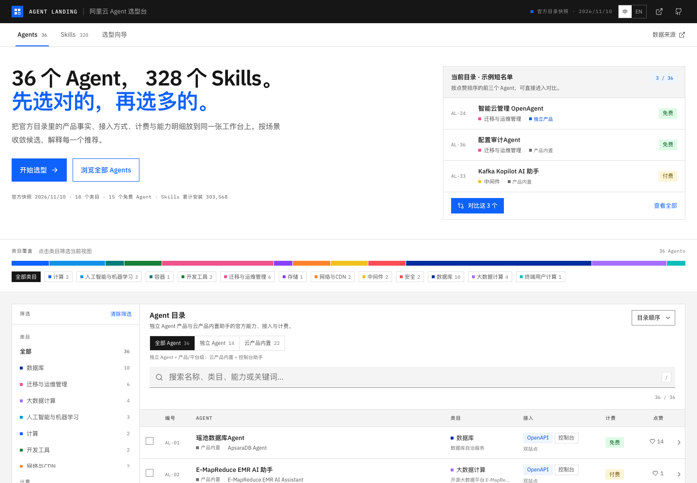
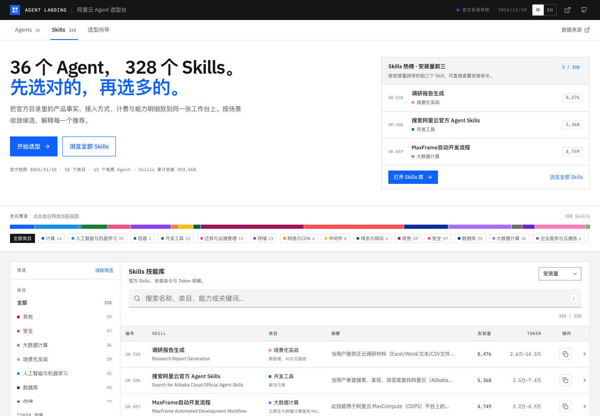
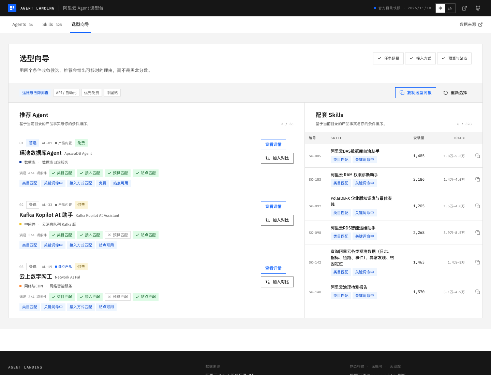

# Agent Landing

> 阿里云 Agent 与 Skills 选型台。把官方目录的 36 个 Agent、328 个 Skills 变成可检索、可对比、可解释的短名单。

Agent Landing 是独立选型工具，不是阿里云官方产品。数据来自阿里云 Agent 服务目录的公开接口，当前快照日期为 **2026-11-10**。



## 当前快照

| 指标 | 数值 |
| --- | --- |
| Agent | 36 |
| 独立 Agent 产品 | 14 |
| 云产品内置 Agent | 22 |
| Skills | 328 |
| 活跃类目 | 18 |
| 免费 Agent | 15 |
| Skill 累计安装 | 303,568 |
| 数据来源 | [agentcatalog.aliyun.com](https://agentcatalog.aliyun.com/) |

## 能做什么

- **独立 Agent / 云产品内置 Agent 分组**：Agent 目录顶部提供类型切换，数据与界面都显式区分独立产品与云产品控制台内置助手。
- **全库检索与多维筛选**：按名称、类目、能力、关键词搜索；按类目、计费、接入方式、站点、Token 规模筛选。
- **Agent 对比**：最多同时对比 3 个 Agent，官方字段并排展示，差异项自动标记，可复制 Markdown 对比摘要。
- **场景选型向导**：用「任务场景 × 接入方式 × 预算 × 站点」四个条件收敛候选，推荐结果给出可核对的条件与理由，而不是黑盒分数。
- **Skills 安装指引**：328 个官方 Skill 均带安装量、Token 范围、类目与 `npx skills add ...` 安装命令，一键复制；复制失败时自动打开详情展示命令。
- **中英双语**：全站 UI 与目录数据均支持中文 / English 切换。
- **可分享状态**：搜索、筛选、排序、对比、详情、选型向导均同步到 URL，可直接分享当前视图。
- **可刷新快照**：数据抓取脚本调用官方公开 API，不需要鉴权。

## Agent 类型

目录中的 36 个 Agent 在数据层标记为两类，并在列表、详情、对比和选型向导中显示：

- **独立 Agent（14）**：以独立产品/平台/角色身份提供能力，不依附于某个云产品控制台。例如 OpenAgent、STAROps 智能运维助手、PAIRec 智能体、小PAI、WinNexO、容器服务 Agent、系统智能专家、云上数字网工、安全运营 Agent、DataBridge、数据治理智能体、Data Agent for Analytics / Forecast、弹性计算 Agent。
- **云产品内置（22）**：嵌入具体云产品控制台/体验的助手，用于该产品的问答、诊断、配置或运维。例如瑶池数据库 Agent、RDS AI 助手、OSS Agent、Kafka Kopilot、RAM 控制台 AI 助手、ESA AI 助手等。

判定边界：像 DAS Agent、PolarDB Agent Express、ROS 智能交付这类能力虽然很强，但仍作为对应云产品的一部分发布，归入「云产品内置」；以独立产品/平台身份发布的 Agent 归入「独立 Agent」。

分类维护在 [`scripts/agent-types.json`](scripts/agent-types.json)。如果团队口径不同，直接修改该文件后执行 `npm run fetch` 即可，界面不需要改动；未列出的新 Agent 默认按 `embedded` 处理并在抓取日志中告警。

## 更多界面

**Skills 库** —— 328 个官方 Skill 的安装量、Token 范围与安装命令：



**选型向导** —— 条件矩阵、可核对理由与配套 Skills：



移动端布局见 [docs/preview-mobile.png](docs/preview-mobile.png)。

## 快速开始

需要 Node.js 20+。

```bash
npm install
npm run dev        # 本地开发，默认 http://localhost:5173
npm run build      # 类型检查 + 生产构建
npm run preview    # 预览生产构建
npm run fetch      # 重新抓取官方目录快照
npm run typecheck  # 仅类型检查
```

## 数据刷新

```bash
npm run fetch
```

脚本位于 `scripts/fetch-catalog.mjs`，会调用以下公开接口并把归一化结果写入 `public/data/catalog.json`。Agent 类型来自 `scripts/agent-types.json`，抓取时会一起写快照：

- `GET /api/public/categories` — 类目树与类目计数
- `GET /api/public/agents/search?pageSize=100&pageNum=1` — 36 个 Agent
- `GET /api/public/agents/{agentId}` — Agent 能力、计费、OpenAPI、控制台入口
- `GET /api/public/skills` — 328 个 Skill 的完整分组列表
- `GET /api/public/skills/{skillName}` — Skill 描述、Token 范围、GitHub 路径

如果你要扩展到其它厂商或目录，保持 `Catalog` 结构不变即可复用全部界面逻辑；数据契约见 `src/types.ts`。

## 项目结构

```text
agent-landing/
├── public/
│   ├── data/catalog.json        # 官方目录快照（36 Agents / 328 Skills）
│   └── favicon.svg
├── scripts/
│   ├── agent-types.json         # 独立 Agent / 云产品内置 分类映射
│   └── fetch-catalog.mjs        # 官方 API 抓取与归一化
├── src/
│   ├── components/              # 目录、对比、详情、向导、筛选等界面
│   ├── hooks/                   # 数据加载与对话框焦点管理
│   ├── lib/                     # i18n、检索/筛选/推荐逻辑、复制与简报
│   ├── App.tsx                  # URL 状态与页面编排
│   └── index.css                # IBM 企业级风格的设计令牌与组件样式
├── PRODUCT.md                   # 产品目标、边界与设计原则
├── DESIGN.md                    # 视觉系统、组件与交互规范
└── .github/workflows/deploy.yml # GitHub Pages 部署
```

## 部署到 GitHub Pages

仓库包含 `.github/workflows/deploy.yml`，默认是**手动触发**，不会在 push 时自动发布。启用方式：

1. 在 GitHub 仓库 **Settings → Pages → Build and deployment** 中选择 **GitHub Actions**。
2. 在 **Actions → Deploy to GitHub Pages → Run workflow** 手动运行一次。

发布地址：

```text
https://ai-guru-global.github.io/agent-landing/
```

构建时 workflow 会设置 `GITHUB_PAGES=true`，Vite 的 `base` 自动切换为 `/agent-landing/`。如果希望每次 push 到 `main` 都自动发布，取消 workflow 中 `push` 触发的注释即可。

## 数据与免责声明

- 数据来自阿里云 Agent 服务目录公开接口，可能存在抓取时点与官方实时页面不一致的情况；以官方页面为准。
- 本项目不虚构评分、排名、客户案例或价格；「推荐」只基于目录字段与用户选择的条件，并展示匹配依据。
- Agent Landing 与阿里云无隶属关系。产品名称、商标与文档归其所有者。
- 发现数据或推荐逻辑问题，欢迎提交 Issue / PR。

## License

[MIT](LICENSE)
